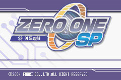
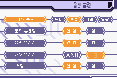

# 제로원 SP — GBA 한글패치

일본판 **Zero One SP**의 비공식 한글패치 **v1.0.0 (2026-10-16)** 입니다. 외부 기계 번역 없이 직접 번역했습니다.

[정식 패치 다운로드](https://github.com/snake759494/zero-one-sp-gba-korean-patch/releases/latest) · [빌드](docs/BUILD.md) · [기술 설명](docs/TECHNICAL.md) · [검증 범위](docs/VALIDATION.md) · [권리 안내](RIGHTS.md)

## 적용 방법

1. 직접 준비한 원본 일본판 ROM의 SHA-256이 아래 `source`와 일치하는지 확인합니다.
2. 릴리즈에서 **Zero_One_SP_GBA_KR.xdelta** 하나를 받습니다.
3. xdelta UI 또는 아래 명령으로 원본에 적용합니다.
4. 결과 ROM의 SHA-256을 확인한 뒤 새로 부팅합니다. 기존 세이브 스테이트보다 콜드 부팅을 권장합니다.

```powershell
.\xdelta.exe -D -d -s 'Zero One SP (Japan).gba' 'Zero_One_SP_GBA_KR.xdelta' 'Zero One SP (Korean).gba'
Get-FileHash -Algorithm SHA256 'Zero One SP (Korean).gba'
```

원본·패치·결과 해시를 한 번에 확인하려면 저장소의 `tools/apply_release.py`를 사용할 수 있습니다.

| 구분 | 바이트 | SHA-256 |
| --- | ---: | --- |
| source | 16,777,216 | `662c5efba869d9d37585eb635d36d68e950f54296c7c569c36381379bee410ba` |
| output | 33,554,432 | `c7f4842e4ea4e48c071845dab40da8bd7843f34f15f29853d305ebbf4048e755` |
| patch | 4,808,697 | `5cf26250902fac31d1f540a99bb98c371d03389d831c52959e72f71286a97a8f` |

xdelta는 **`-0 -S none -D`**로 빠르게 생성했습니다. 릴리즈 첨부는 xdelta 하나이며 ROM·폰트·외부 실행파일·저장 파일은 포함하지 않습니다.

## 한글화 내용

- 본편 129개 자원과 추출된 분기의 대사·선택지·시스템 안내. 진단 자원 3개는 보존했습니다.
- 본편·기존 UI 69,759곳과 사건 기록·인물·용어 사전 1,540곳: 총 **71,299곳**에 번역을 반영했습니다. 위치 수는 고유 문장 수와 다릅니다.
- 본문 사전 43,522항목, 문맥별 번역 105항목, 추가 번역 자료 1,066종, 이름 표 49개.
- 그림 자원 820개를 검토하고 121개를 수정했습니다. 장 제목·메뉴·이름판·간판·메모 독음·미니게임 안내·선택 이름·책 표지·게이지 표시를 포함합니다.
- 갈무리7·9·11 Condensed·14 원래 비트맵을 사용했습니다. 확대·축소하지 않으며 팔레트와 타일 용량, 문구 영역 밖 픽셀을 검사했습니다.
- 옵션 화면의 원문 잔여 획과 배경 줄무늬를 제거하고 대사 속도 네 선택지를 각 칸 중앙에 맞췄습니다. 네 속도의 선택 상태에서 실제 글리프 픽셀을 확인했습니다.

 

## 검증 범위와 보존 사항

최종 해시의 ROM으로 VBA 콜드 부팅, 옵션 진입·복귀, 다섯 행과 네 대사 속도 선택, 처음부터 메뉴, 도입부 대사와 이름창을 확인했습니다. 원본 적용 및 공개 도구 재빌드의 결과 해시도 대조합니다. 검증에 사용한 VBA는 종료했습니다.

**전편 플레이, 모든 실제 분기·엔딩·미니게임, 추가 사전 전체의 실제 화면, 최신 저장·불러오기, 실기 검증은 미실시입니다.** 정적 자원 검사와 표본 실행 검증을 구분합니다.

판독할 수 없는 미세 문양 5영역, 원래 문자 아틀라스, 기호·버튼 표기와 고유 로고는 보존했습니다. 거울문자 메모는 퍼즐의 원래 획을 유지하고 독음을 덧붙였습니다. 자세한 내용은 [검증 문서](docs/VALIDATION.md)를 확인하세요.

## 공개 자료

`translation/`에는 직접 번역한 자료를, `tools/`에는 빌드·검증 도구를 공개합니다. 긴 원문은 사용자 ROM에서 읽는 위치 참조로 구성했으며 원본 추출 스크립트 전체를 배포하지 않습니다. 재빌드에는 사용자가 준비한 원본 ROM과 해시가 맞는 공식 갈무리 글꼴이 필요합니다. 이 저장소는 원작이나 글꼴의 권리를 부여하지 않습니다.

문제 제보에는 원본·결과 ROM 해시, 발생 위치, 재현 순서와 화면 캡처를 첨부해 주세요. ROM 파일과 저장 파일은 공개 이슈에 올리지 마세요.
